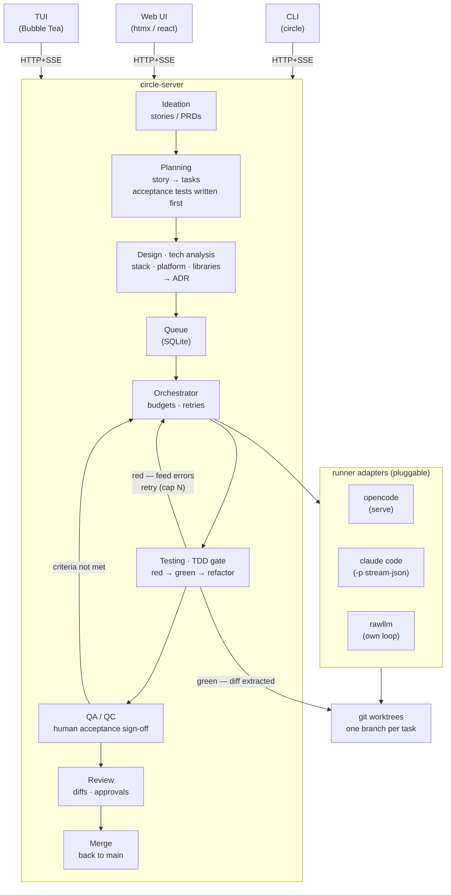

# circle

Agent-orchestration platform for the full SDLC, TDD-driven.
Submit a user story → it is planned into tasks with acceptance tests
(failing tests first) → tech/platform options are analyzed against the
requirements → coding agents (opencode, claude code, raw LLM) implement
them in git worktrees red → green → refactor → tests gate progress →
human QA sign-off → diffs are reviewed → merge.



## Layout

| Path                  | Purpose                                        |
| --------------------- | ---------------------------------------------- |
| `cmd/circle`           | swiss-army CLI (submit stories, watch runs)    |
| `cmd/circle-server`    | headless HTTP API + SSE server                 |
| `cmd/circle-tui`       | terminal UI client (Bubble Tea)                |
| `internal/domain`     | pure types: Story, Task, Run, Event, states    |
| `internal/store`      | SQLite persistence + migrations                |
| `internal/orchestrator`| queue, budgets, retry loop                    |
| `internal/runner`     | Runner interface + registry + adapters         |
| `internal/gitops`     | worktree/branch/diff helpers                   |
| `internal/api`        | HTTP + SSE handlers                            |
| `web/`                | web UI (later)                                 |
| `.circle/`             | project config                                 |

## Getting started

```sh
make build        # builds bin/circle, bin/circle-server, bin/circle-tui
make run-server   # starts API on :8080
curl :8080/healthz
```

## Status

Skeleton only — runner adapters and orchestrator are stubs.
See `docs/ROADMAP.md`.
