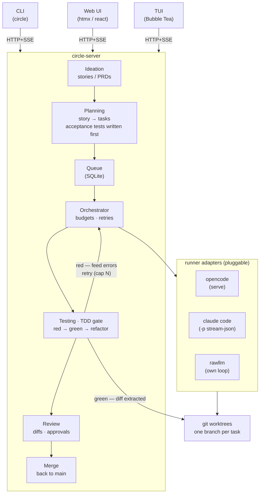

# Lifecycle

circle drives the full SDLC with a TDD approach:

**ideation → planning → implementation → testing → review → merge**

## Stages

| Stage          | Input                    | Output                              |
| -------------- | ------------------------ | ----------------------------------- |
| Ideation       | idea / PRD               | `Story` (draft)                     |
| Planning       | `Story`                  | `Task`s + acceptance tests (red)    |
| Implementation | `Task`                   | worktree changes (red → green)      |
| Testing        | worktree                 | green tests + diff, or retry        |
| Review         | diff                     | approval or re-queue                |
| Merge          | approved diff            | change on main                      |

## Test gate

Failing acceptance tests are written at planning time. The gate only releases a
task to review on **green**; a **red** result feeds the errors back to the
orchestrator for a bounded retry (`budgets.max_retries` in
`.circle/config.yaml`).

## State transitions

Story (`internal/domain/story.go`): `draft → triaged → planned → done`, plus
`cancelled`.

Task (`internal/domain/task.go`): `queued → running → review → merged`, with
`failed` and re-queue loops. The TDD gate sits inside `running → review`.
