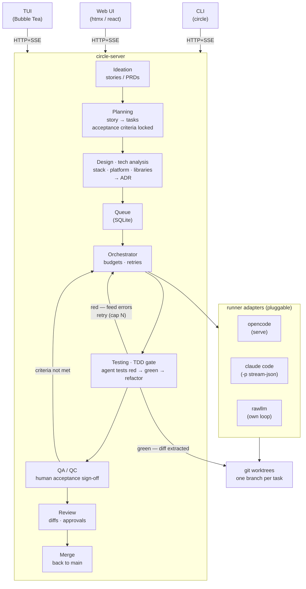

# Lifecycle

circle drives the full SDLC with a TDD approach:

**ideation → planning → design (tech analysis) → implementation → testing →
review → merge**



## Stages

| Stage           | Input                    | Output                              |
| --------------- | ------------------------ | ----------------------------------- |
| Ideation        | idea / PRD               | `Story` (draft)                     |
| Planning        | `Story`                  | `Task`s + locked acceptance criteria|
| Design          | `Task`s + constraints    | ADR: stack, platform, libraries     |
| Implementation  | `Task`                   | worktree changes (red → green)      |
| Testing         | worktree                 | agent tests green + diff, or retry  |
| QA / QC         | green diff               | human acceptance sign-off           |
| Review          | approved diff            | approval or re-queue                |
| Merge           | approved diff            | change on main                      |

## Tech analysis

Before implementation, the requirements are analyzed against the technology that
can satisfy them. This stage selects:

- **Stack** — language, framework, runtime
- **Platform** — host, CI, deployment target, managed services
- **Libraries / infra** — dependencies, datastores, integrations

Output is a decision record (ADR) attached to the story/tasks. Agents can
propose and compare options, but consequential choices (platform, paid services,
external infra) are a **human gate** — the same manual-approval rule as QA. The
chosen stack then becomes a constraint passed into every runner for that story.

## Test layers

Testing is split along two independent axes: **who authored** it and **what
gates** it.

| Layer                     | Author | Purpose                                        | Gate       |
| ------------------------- | ------ | ---------------------------------------------- | ---------- |
| Acceptance (QA / QC)      | human  | prove the user acceptance criteria are met     | manual     |
| Coverage / edge / pattern | agent  | coverage, edge cases, common patterns, regress | automated  |

- **Human acceptance tests** are authored during planning from the locked
  acceptance criteria and verified by a person (`verified_by`). They are
  read-only to runners — an agent must never be able to rewrite the tests that
  judge it.
- **Agent tests** are authored during implementation and run in the automated
  TDD gate.

The automated gate only releases a task on **green**; a **red** result feeds
the errors back to the orchestrator for a bounded retry (`budgets.max_retries`
in `.circle/config.yaml`). The manual gate is never auto-passed: the task parks
until a human identity records the sign-off.

```sql
CREATE TABLE IF NOT EXISTS tests (
    id          TEXT PRIMARY KEY,
    task_id     TEXT NOT NULL REFERENCES tasks(id),
    author      TEXT NOT NULL,   -- human | agent
    kind        TEXT NOT NULL,   -- acceptance | coverage | edge | pattern | regression
    title       TEXT NOT NULL,
    body        TEXT NOT NULL,
    status      TEXT NOT NULL,   -- pending | pass | fail
    evidence    TEXT,            -- log / diff / screenshot ref
    verified_by TEXT,            -- required when author = human
    verified_at DATETIME
);
```

## State transitions

Story (`internal/domain/story.go`): `draft → triaged → planned → done`, plus
`cancelled`. A `designed` status after the tech-analysis gate is still to be
added.

Task (`internal/domain/task.go`): `queued → running → review → merged`, with
`failed` and re-queue loops. The automated TDD gate sits inside
`running → review`; the human QA gate sits between them and must be cleared
before review. Tech analysis runs once per story before tasks are queued.
