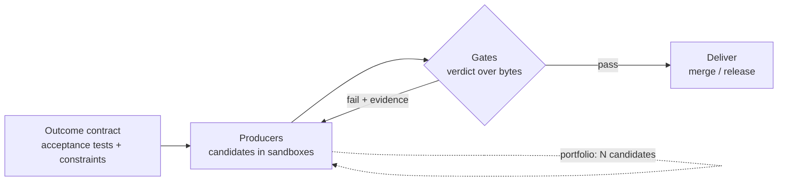

# Outcomes

> Lock the **outcome**, not the implementation. Any candidate that satisfies the
> contract is delivered — the *how* is a search result, not a decision.

circle does not ship code; it ships **verdicts over bytes**. A runner produces
bytes in a sandbox, a gate judges those bytes, and the pipeline only advances on
a passing verdict. This document is the high-level model; the "Under the hood"
section maps it to concrete types and files.

## The same cycle, every time

The lifecycle in [LIFECYCLE.md](LIFECYCLE.md) is one instance of a general loop.
It is identical whether the deliverable is a todo app, a service, a CLI, an
infra change, or a doc — only the **contract** changes.



The loop is fixed; everything inside it is replaceable. That is what makes the
system "spin up faster": a new capability is a new gate or producer wired into
the same loop, never a new pipeline.

## The outcome contract

The unit of truth is executable, not prose.

| Layer        | Author | Source of truth                    | Gate      |
| ------------ | ------ | ---------------------------------- | --------- |
| Functional   | human  | acceptance tests (locked)          | automated |
| Non-functional | human/agent | measured constraints            | automated |
| Risk / quality | agent/tools | findings + policy              | automated |
| Acceptance   | human  | criteria sign-off                  | manual    |

- **Functional** — the behavior the user asked for, frozen as tests in planning.
  Read-only to producers: an agent must never rewrite the tests that judge it.
- **Non-functional constraints** — perf (p95 < 200ms), dependency budget,
  license allowlist, artifact size, target host/runtime, $/time budget.
- **Prose (PRD, ADR)** is for humans. The machine only trusts tests and checks.

> **Implementation is free.** For "build a todo app", Go+SQLite, Node+Postgres,
> Rust+file, or a static SPA are all admissible. Pick none up front — let the
> gates choose.

## Implementation is a portfolio

Because the *how* is unconstrained, run candidates, not a decision.

- One contract, **N candidates** in isolated sandboxes (worktree or container).
- Keep the cheapest candidate that turns **all** gates green.
- Stack / platform selection moves from a *human mandate* (today's Design stage)
  to an *emergent result* — a constraint only when it must be.
- Optimization (fewest tokens, fastest, smallest, least deps) is a **tiebreak
  among candidates that already deliver**.

## Gates are uniform

A gate is read-only over produced bytes and emits a `Verdict`. It never mutates
the candidate (only producers write).

| Gate                | Input bytes        | Output              | Decides              |
| ------------------- | ------------------ | ------------------- | -------------------- |
| Behavior            | worktree           | pass/fail per test  | functional           |
| Constraint          | worktree + host    | measured vs limit   | perf, size, deps     |
| Risk / security     | diff               | `Finding[]`         | block on severity    |
| Critic (LLM review) | diff + contract    | `Finding[]`         | block on policy      |
| Human QA            | green candidate    | sign-off            | manual, never auto   |

The pipeline order is **produce → behavior → constraint → risk → critic → human
QA → review → merge**. A fail at any automated gate feeds evidence back to the
producer for a bounded retry (`budgets.max_retries`).

## Risk & review gate (CodeRabbit-like)

A critic is just another gate whose deliverable is **findings, not code**. It
answers "what is risky here and why", not "how I would have written it".

**Toolbox (all optional, all normalized to the same shape):**

- static analysis: `semgrep`, `gosec`, `staticcheck`
- dependency / vulnerability: `govulncheck`, `osv-scanner`, `trivy`
- secrets: `gitleaks`
- deep/dataflow: `CodeQL`
- license / SBOM: `syft`, license scanners
- LLM critic: reads diff + contract, emits design/risk findings

**Normalized finding:**

```go
type Finding struct {
    ID       string
    Category string   // security | correctness | performance | design | license | secret
    Severity string   // info | low | medium | high | critical
    File     string
    Line     int
    Rule     string
    Message  string
    Evidence string   // raw tool output / snippet ref
    Source   string   // semgrep | govulncheck | llm-critic | ...
    Blocking bool     // derived from policy
}
```

**Policy** (`.circle/config.yaml`) turns findings into a verdict:

```yaml
risk:
  block_severity: high          # findings >= high fail the candidate
  allow:                        # explicit suppressions (require rationale)
    - rule: G404
      reason: "math/rand is fine for jitter here"
  categories: [security, correctness, license, secret]
```

Findings are attached to the task and surfaced in review/QA. A blocking finding
fails the candidate exactly like a red test — same loop, same retry budget.

## Systematic methodology

The point of a fixed loop is reuse:

- **Add a capability = add a gate + config**, never a new pipeline.
- **Templates** to copy and modify: `internal/runner/template` (producer),
  and (planned) `internal/gate/template`, `internal/critic/template`.
- **Determinism where it matters**: gates re-run tools on the same bytes, so a
  verdict is reproducible regardless of which agent produced the candidate.
- **Producers are interchangeable**: opencode, claude, rawllm, aider, a shell
  script — all equal if they deliver the same green.

## Under the hood

The model is intentionally thin so it is easy to inspect. Proposed additions,
alongside what already exists:

| Concept      | File                        | Status    |
| ------------ | --------------------------- | --------- |
| Producer     | `internal/runner/runner.go` | exists    |
| `RunSpec`/`RunResult` | `internal/domain/event.go` | exists |
| Event stream | `internal/domain/event.go`  | exists (telemetry only) |
| `Constraint` | `internal/domain/gate.go`   | planned   |
| `Finding`    | `internal/domain/gate.go`   | planned   |
| `Verdict`    | `internal/domain/gate.go`   | planned   |
| `Gate` iface | `internal/gate/gate.go`     | planned   |
| Critic adapter | `internal/critic/*`       | planned   |
| Policy       | `.circle/config.yaml`       | partial   |

Sketch of the planned domain types:

```go
type Constraint struct {
    Name   string
    Check  string // command or built-in (perf, license, deps, size)
    Limit  string // e.g. "p95<200ms", "no-gpl", "deps<=30"
}

type Verdict struct {
    Pass     bool
    Findings []Finding
    Evidence []Evidence // diff, test log, tool output refs
}

type Gate interface {
    Name() string
    Judge(ctx context.Context, cand Candidate) (Verdict, error)
}
```

Events remain **telemetry**: the orchestrator must never depend on rich event
kinds (`tool_call`, `patch`, …) to decide pass/fail. Truth lives in the gate
verdict over disk bytes, not in the agent's self-report.

## Principles

1. **The contract is the only fixed thing.** Tests + constraints; prose is for humans.
2. **Never trust self-report.** Re-read the bytes: diff from git, tests re-run.
3. **Gates are uniform and read-only.** Same shape for behavior, risk, critic.
4. **Implementation is a search, not a decision.** Portfolio, gate-selected.
5. **Failures are evidence**, fed back into the same bounded retry loop.
6. **Kind is irrelevant.** Any producer/tool that delivers a green verdict wins.
